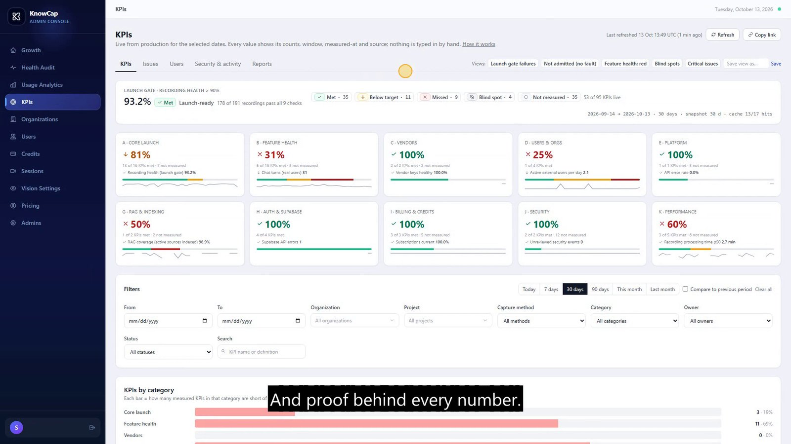
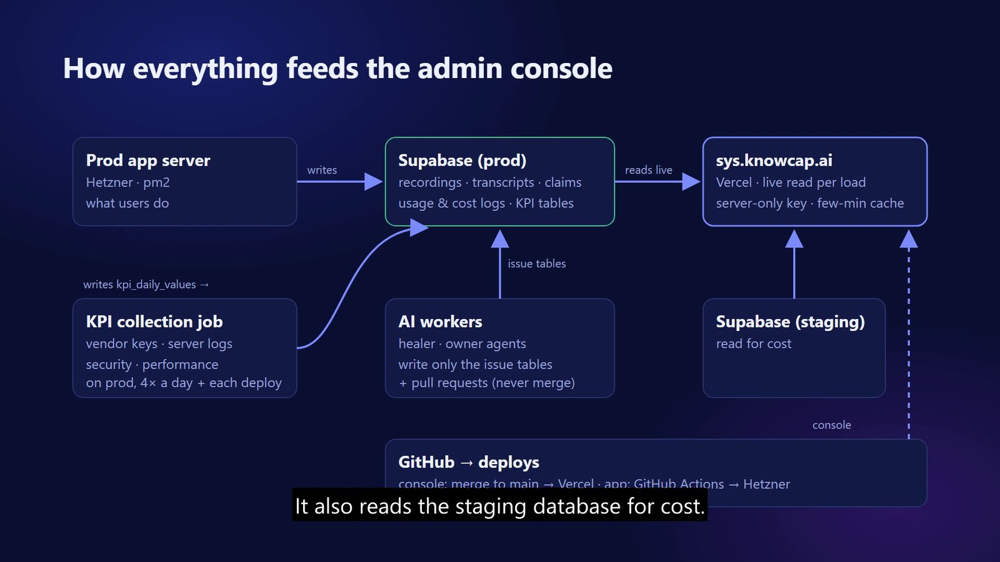
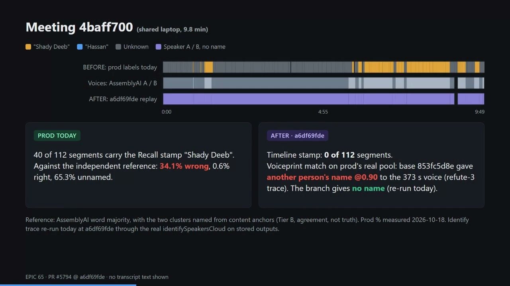
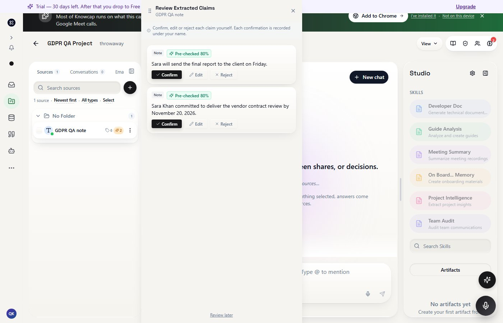
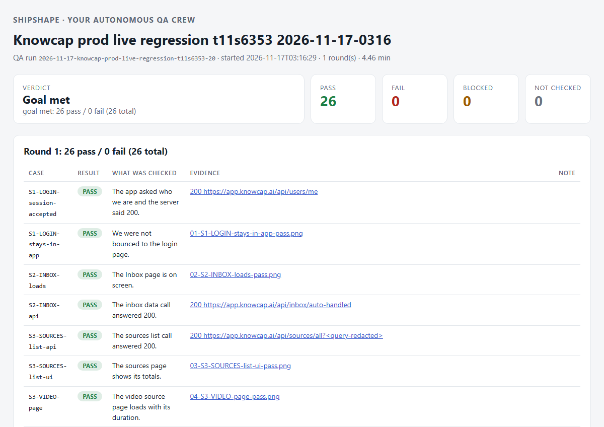
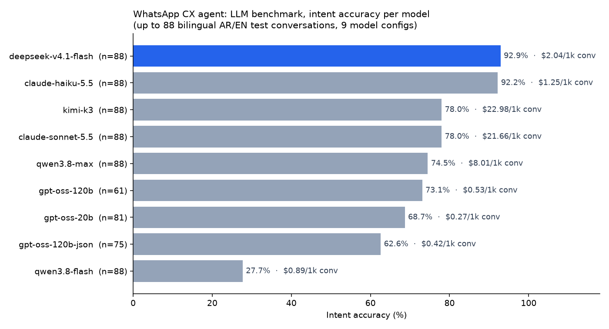
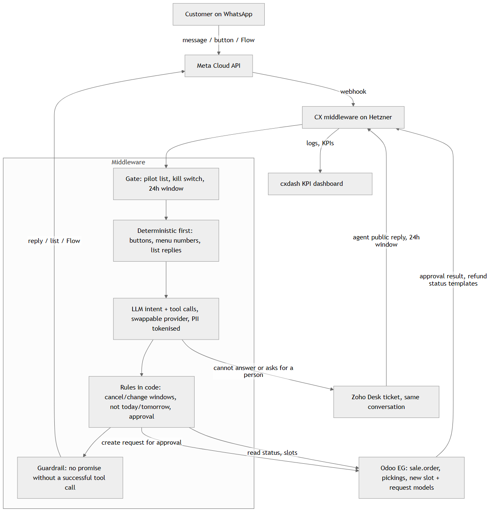
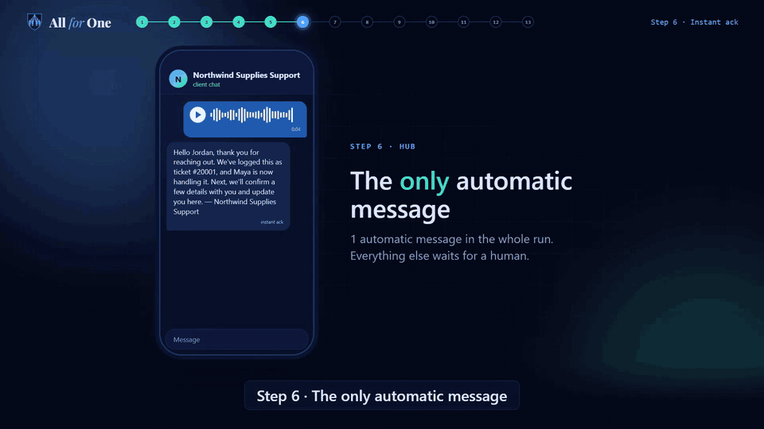
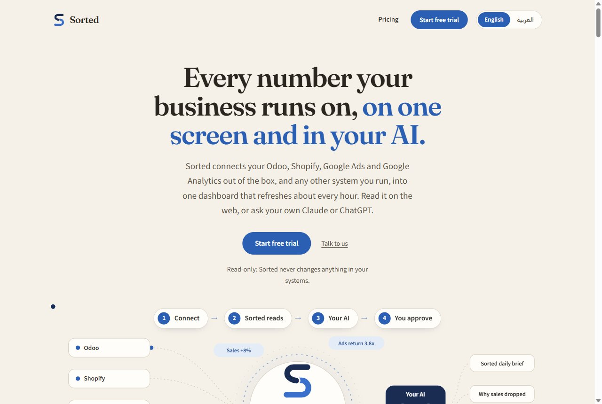
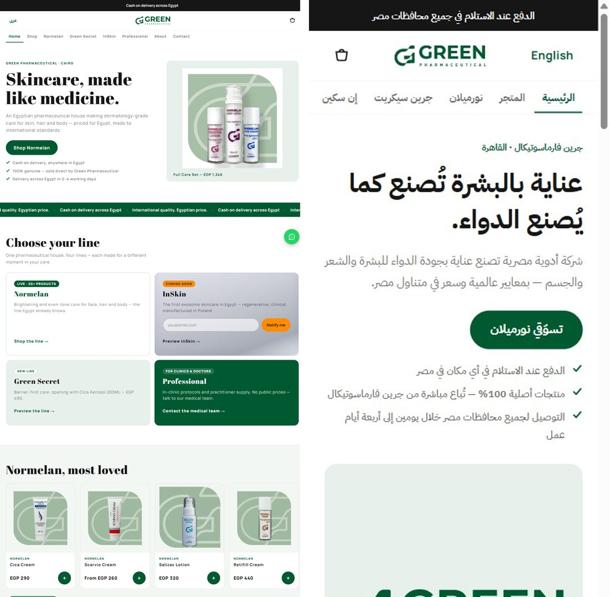

# Shady Al-Halawani

### AI Product Manager & Tech Lead · I ship what I spec

**Cairo, Egypt** · MSc Computer Science (Distinction), University of Roehampton, London

[📅 Book a call](https://calendly.com/shady-al-halawani) · [Email](mailto:shadydeeb4@gmail.com) · [LinkedIn](https://www.linkedin.com/in/shady-al-halawani-333a5419a) · [Selected work](#-selected-open-source) · [Client delivery](#-client-delivery) · [Evidence](#-evidence) · [Freelance](#️-freelance--consulting) · [Leadership](#-leadership)

---

I lead AI products end to end: **spec → architecture → code → evals → production**, and the team in between.
I took an AI SaaS from an outsourced agency to an in-house team, rebuilt its AI layer, and built the agent tooling that lets a small team ship like a big one.

**2,000+ merged pull requests · 1,300 issues · 6,300+ contributions in 2026**, mostly in private company repos.

---

## 🧭 Leadership

- **Tech lead and AI PM at [Knowcap.ai](https://knowcap.ai)** (SMETools). I moved delivery from an outside agency to an in-house team, hired the developers, and own the platform's architecture, releases and roadmap.
- **I run a hybrid team of humans and AI agents.** Role agents (tech lead, PM, security, QA, DevOps) work in parallel Claude sessions next to the human team, under one rule: **every PR gets an independent code review, a security review and green CI before it merges.**
- **I own the staging release line:** staging-first deploys, GitHub Actions CI/CD, and rollback readiness.
- **I lead product engineering at [Sorted](https://sortedos.com)** (Nov 2026), a business-dashboard SaaS. I run a multi-role agentic build pipeline, shipped a real-time CX dashboard, and took the backlog from 85 to about 55 open tickets, each closed with evidence.
- **I run client delivery** for SMETools' agency work (below), plus Meta business verification and the WhatsApp Cloud API Tech Provider setup.
- **I mentor**, including running an engineering internship with a structured quest track and a mini-ERP project.

## 🚚 Client delivery

| Project | What I delivered | Outcome |
|---|---|---|
| **Ariika CX** | Customer-experience automation for a furniture e-commerce company. Odoo 17 → Python middleware → Zoho Desk → WhatsApp Cloud API, with signed webhooks, Meta template approvals, a security gate and secrets handling, staging plus production, and a live ops dashboard. Built with a multi-agent team (tech lead, Odoo, integration, QA, security agents) | **Live 10 Nov 2026.** **1,186 customers messaged, 1,156 reached (97.5%)**, ~98% delivery. Found that 71 of the first 78 tickets were replies to "order confirmed" messages and shipped a rule that stopped them opening tickets |
| **Ariika CX: AI agent** | An Arabic and English support agent: a state machine plus an intent-only LLM, with rate limits, PII redaction, a promise guard and hand-over to a human (on staging) | Benchmarked **9 LLMs on 88 real conversations** and picked a low-cost model with **92.9% intent accuracy**, the best of those tested |
| **Ariika Flow** | An Odoo 17 integration with a logistics platform, plus a mock server and webhook replayer for testing | Sole author, 129 commits |
| **All for One** | A WhatsApp → Odoo helpdesk hub. AI drafts each reply, an AI judge scores it, and a human approves it | Live pilot on a Meta-verified WhatsApp Business number: first ticket **within ~5 s** of the message. 2,700+ automated tests. [Open-core repo ↓](https://github.com/Shadysmetools/all-for-one-hub) |
| **Live KPI feed** | Streams CX metrics into the client owner's business dashboard | Reusable for other clients through config alone |

## 🛍️ Freelance & consulting

| Client / offer | What I built | Proof |
|---|---|---|
| **Green Pharmaceutical**, a skincare brand in Egypt | A full Shopify store in Arabic and English: custom theme, product catalogue, checkout (cash on delivery or card), analytics | 180+ commits, sole developer · [theme concepts](https://github.com/Shadysmetools/gp-theme-options) |
| **OKO** | A Shopify store build: Dawn-based theme, product data sheets and a bulk catalogue import, product imagery | Catalogue → Shopify import pipeline |
| **Radwan El Ogail** | Automated the client's entire product data entry and website build, from product data straight to a live storefront | End-to-end automation, no manual entry |
| **Odoo + AI consulting** | A bilingual (AR/EN) business-system offer: ERP, CRM, website and a WhatsApp AI assistant on Odoo Community, with fixed-price packages and a savings calculator | [Proposal site](https://github.com/Shadysmetools/business-proposal) |

## 🏗️ Knowcap platform (private)

- **AI-agent release process for the December 2026 launch:** every fix starts with failing tests, then gets an independent review agent, staging, then production. On 16–17 Nov: 3 releases and 10+ fixes, each passing a 26/26 automated production test. The backlog went from 148 to 118 AI-reported and from 32 to 18 human-reported cards in about 30 hours.
- **Zero-downtime blue/green production deploys**, plus security hardening: single-use connector login codes, a fail-open sign-in path closed, voiceprint access scoped per workspace, session tokens removed from URLs.
- **A KPI programme with dated targets:** recording health, capture coverage, speaker identification, claims accuracy and AI-cost coverage. Each baseline was measured live in production and tied to the code change that moves it, and an admin KPI dashboard shows every number with the date it was measured.

- **Hybrid hierarchical RAG** (semantic + BM25, reranking, project memory layers) replaced a single-prompt Gemini flow, backed by an extraction eval harness.
- **Multi-provider LLM orchestration** with fallback routing: Gemini, Claude, OpenRouter, and Groq Whisper for Arabic and English speech-to-text.
- **Knowcap Mobile:** sole author of the iOS and Android app (Expo, React Native, TypeScript).
- **MCP servers**, an API/MCP access paywall, self-hosted voiceprints, and a two-way ClickUp/Odoo sync engine.
- About **38% of all commits** on the platform monorepo: frontend, services, API, database, tests and CI.

## 🧰 Selected open source

| Project | What it is | Stack |
|---|---|---|
| [**all-for-one-hub**](https://github.com/Shadysmetools/all-for-one-hub) | A self-hosted support hub: WhatsApp messages and voice notes become helpdesk tickets, AI drafts and scores replies, and nothing is sent until a named human approves | Python · Rust/Tauri · LLM-as-judge |
| [**support-twin**](https://github.com/Shadysmetools/support-twin) | A self-hosted AI digital twin for support teams: it works helpdesk tickets, mail and chat in your agent's voice, with human approval gates. Installs in 2 minutes; 3,000+ tests | Python · LLM agents · Odoo/WhatsApp/Telegram |
| [**onboarding-quest**](https://github.com/Shadysmetools/onboarding-quest) | Gamified onboarding for new hires and interns: daily quests, quizzes, Telegram check-ins and a mentor dashboard. One-click Vercel deploy | Node.js · Vercel · Upstash · Telegram |
| [**shipshape**](https://github.com/Shadysmetools/shipshape) | A Claude Code plugin: one sentence becomes a recorded, verified QA pass. Agents test in a real browser twice, record narrated videos, and try to disprove every failure before filing it | Python · Playwright · Claude Code |
| [**claude-super-workflow**](https://github.com/Shadysmetools/claude-super-workflow) | A 13-role AI engineering team (tech lead, PM, security, QA, DevOps…) orchestrated through a shared blackboard | JavaScript · multi-agent |
| [**claude-skills**](https://github.com/Shadysmetools/claude-skills) | Claude Code skills I use daily: an ops manager, KPI self-healing, a routine creator, a team orchestra, and a worktree shipper | Claude Code · agents |
| [**kalam**](https://github.com/Shadysmetools/kalam) | A programming language where SQL injection and XSS are type errors, written in English, Arabic or Egyptian Franco. Lexer, parser and type checker: 914 tests, 24-hour fuzz run with 0 crashes | Rust · compilers |
| [**whatsapp-persona-bot**](https://github.com/Shadysmetools/whatsapp-persona-bot) | A WhatsApp auto-reply bot that writes in your voice using a local Ollama model, with an allowlist and privacy-first design | Node.js · Ollama |
| [**Free-CLI**](https://github.com/Shadysmetools/Free-CLI) | A free, open coding agent in the style of Claude Code that runs on Ollama, Groq and other free providers | TypeScript · MCP |
| [**aether-sigil**](https://github.com/Shadysmetools/aether-sigil) | *Emberwick*, an original lantern-light tactics game for iOS and Android | Godot · GDScript |

## 📸 Evidence

| | |
|---|---|
|  **Knowcap admin console:** a live launch-gate KPI dashboard (93.2% recording health, 95 KPIs across 10 categories), every value pulled from production. |  **Knowcap KPI pipeline:** a collection job, AI healer/owner agents and Supabase feed sys.knowcap.ai; deploys run through GitHub Actions, Vercel and Hetzner. |
|  **Before/after for EPIC 65 (speaker naming):** measured 34.1% wrong speaker labels in production. Replaying the fix branch on the same meeting left the speakers unnamed instead of naming them wrongly. |  **Knowcap claim review:** AI-extracted claims come pre-checked, and a person confirms, edits or rejects each one (staging test project). |
|  **ShipShape autonomous QA:** a live Knowcap production regression run finished at 26 pass / 0 fail in 4.46 min, with evidence for each case. |  **WhatsApp CX agent model selection:** 9 model configs benchmarked on up to 88 bilingual test conversations. The best scored 92.9% intent accuracy at $2.04 per 1k conversations. |
|  **WhatsApp CX automation architecture:** deterministic flows first, then an LLM with tool calls. Rules live in code, a guardrail blocks any promise without a successful tool call, and the system hands off to Odoo and Zoho Desk. |  **All for One (open source):** a WhatsApp voice note becomes a helpdesk ticket, the AI drafts a reply, an LLM judge scores it, and a human approves it before it is sent (synthetic demo data). |
|  **Sorted:** a SaaS that puts Odoo, Shopify, Google Ads and GA4 numbers on one dashboard and in your own AI, with an EN/AR landing page. |  **Green Pharmaceutical Shopify storefront:** a bilingual English (desktop) and Arabic RTL (mobile) build with a cash-on-delivery focus. |

## 🛠️ Stack

  

| Area | Tools I've shipped with |
|---|---|
| **Languages** | TypeScript · Python · Rust · JavaScript · SQL · GDScript · Liquid · PowerShell · Bash · Groovy · HTML/CSS |
| **LLMs & AI** | Claude (Opus/Sonnet/Haiku) · Gemini (Flash/Pro, Genkit) · OpenRouter · Groq · Ollama (local models) · ElevenLabs · ACE-Step · ComfyUI |
| **AI engineering** | Hybrid RAG (pgvector, BM25, reranking, contextual retrieval) · LLM evals & LLM-as-judge · prompt management · multi-agent orchestration · MCP servers · Claude Code plugins, skills & hooks · PII redaction & guardrails |
| **Speech & media** | Speaker diarization (pyannote, AssemblyAI) · self-hosted voiceprints & speaker identification · Groq Whisper STT (Arabic + English, language detection, timestamps) · ElevenLabs TTS · Recall.ai meeting bots · LiveKit real-time voice · ffmpeg |
| **Frontend & mobile** | React · Next.js · Vue/Quasar · React Native/Expo · NativeWind · Zustand · TanStack Query · Tauri 2 (desktop) · Chrome MV3 extensions · Godot 4 |
| **Backend & data** | Node/Express · Python services · PostgreSQL · Supabase (RLS, multi-tenant) · SQLite · SQL migrations · webhooks & queues |
| **Business systems** | Odoo 17 (custom modules, ERP/CRM, helpdesk) · Shopify (themes, Liquid, catalogue import) · Zoho Desk · ClickUp · Gmail/Google Workspace |
| **Meta** | WhatsApp Cloud API · Meta Business verification · Tech Provider & Embedded Signup · App Review · Meta Ads (Marketing API) |
| **Google** | Gemini & Vertex AI · Google Ads API · Google Analytics 4 (Data & Admin APIs) · Google Cloud · Google Workspace (Gmail, Calendar, Drive) |
| **Other integrations** | Odoo XML-RPC/JSON-RPC · Shopify Admin API · Zoho Desk · ClickUp (two-way sync) · Telegram Bot API · Baileys · Recall.ai · Supabase Auth · usage credits & API paywall · webhooks for all of the above |
| **Testing & quality** | Regression testing with [ShipShape](https://github.com/Shadysmetools/shipshape) (recorded browser runs on every release, 26/26 production suite) · load testing · Playwright E2E · pytest · cargo test · fuzzing · TDD · AI code-review gates |
| **Security** | Security review on every PR · gitleaks secret scanning · auth hardening (single-use codes, fail-closed sign-in, tokens out of URLs) · multi-tenant RLS isolation · PII redaction · prompt-injection guards · penetration testing (TCM Practical Ethical Hacking, Junior Penetration Tester) |
| **DevOps & cloud** | Ubuntu servers · UFW firewall & SSH hardening · Nginx (reverse proxy, TLS, hardening) · Docker · PM2 · GitHub Actions (self-hosted runners) · Jenkins · blue/green zero-downtime deploys · Hetzner · Vercel |
| **Cloudflare** | DNS · Cloudflare Access (zero-trust login) · Tunnels · Workers · WAF & DDoS protection · WARP |
| **Product** | PRDs & specs · KPI design · LLM benchmarking · backlog triage · staging-first releases · Odoo/ClickUp boards |

---

**Let's build something: AI products, agents, integrations and consulting**

📧 [shadydeeb4@gmail.com](mailto:shadydeeb4@gmail.com) · 💼 [shady@smetools.io](mailto:shady@smetools.io) · 📱 [+20 120 546 1115](tel:+201205461115) · 📅 [Book a call](https://calendly.com/shady-al-halawani) · 🔗 [LinkedIn](https://www.linkedin.com/in/shady-al-halawani-333a5419a)

